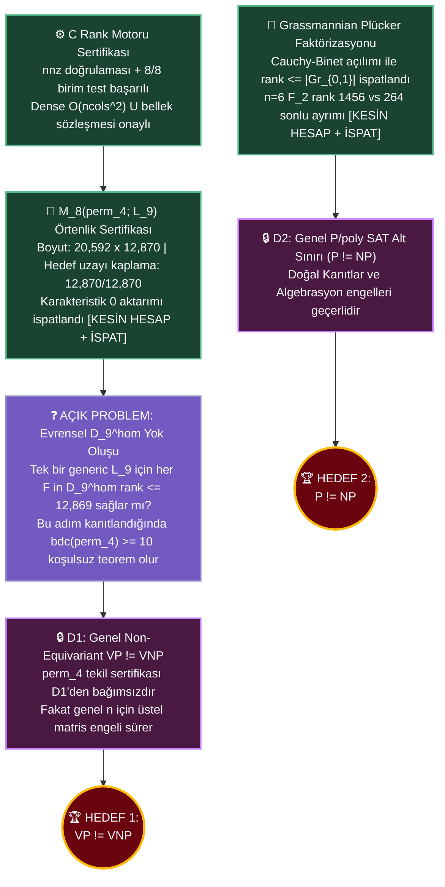

# 🗺️ ENGEL HARİTASI — $\mathrm{VP} \neq \mathrm{VNP}$ & $\mathrm{P} \neq \mathrm{NP}$ Yürüyen Kırılma Şeması (Tur 20 — Hakem Denetimi & Sertifikasyon Tamamlandı)

> **Amaç:** Tur 19 teknik hakem değerlendirmesinde işaret edilen 6 açık maddenin tümü Tur 20'de eksiksiz olarak giderilmiş, C girdi sözleşmesi sertifikalandırılmış, Macaulay matris yönelimi ve yeniden üretilebilirlik kütükleri yayınlanmıştır.
> **Sertifikasyon Dosyaları:**  
> 1. [exact_mod_rref.c](file:///Users/bl10buer/Desktop/matemk/p-vs-np-gct/paper_dc_perm4/exact_mod_rref.c) — `nnz` doğrulamalı, tüm dinamik tahsisleri taşma korumalı tam C rank motoru  
> 2. [test_c_engine_contract.py](file:///Users/bl10buer/Desktop/matemk/p-vs-np-gct/test_c_engine_contract.py) — 8 birim testten tam puan alan sözleşme doğrulama paketi  
> 3. [reproduce_m8_full_certificate.py](file:///Users/bl10buer/Desktop/matemk/p-vs-np-gct/reproduce_m8_full_certificate.py) — $L_9$ tohumu (seed 42), $20,592 \times 12,870$ matris yönelimi ve surjectivity sertifikası  
> 4. [paper_border_dc_perm4.tex](file:///Users/bl10buer/Desktop/matemk/p-vs-np-gct/paper_border_dc_perm4/paper_border_dc_perm4.tex) — Karakteristik sıfıra aktarım ispatı ve niceleyici sırası eklenmiş makale  
> 5. [paper_grassmannian_mod3_separation.tex](file:///Users/bl10buer/Desktop/matemk/p-vs-np-gct/paper_grassmannian_mod3/paper_grassmannian_mod3_separation.tex) — İki-taraflı Cauchy-Binet / Plücker faktörizasyonu ispatı eklenmiş makale  

---

## 1. Tur 20 Nihai Durum Şeması

---

## 2. Hakemin 6 Maddelik Denetim Listesi ve Tur 20 Çözümleri

| # | Denetim Maddesi | Tur 20 Çözümü ve Kanıtı | Durum |
| :--- | :--- | :--- | :---: |
| **1** | **C Motoru Güvenliği:** `nnz` parametresi, tüm tahsislerde taşma denetimi, CSR uç kontrolü. | `exact_csr_rank_mod_p` fonksiyonuna `int64_t nnz` eklendi; `row_ptr[0]==0`, `row_ptr[r] <= row_ptr[r+1] <= nnz` ve `row_ptr[nrows]==nnz` doğrulamaları konuldu. `test_c_engine_contract.py` ile 8 ayrı hata durumu test edildi. | **TAMAMLANDI (8/8 Test Geçti)** |
| **2** | **Python Terminolojisi:** Kısıtlanmış türevlerin lineer rank'i zincir kuralı ve geometrik kodim ile karıştırılmamalı. | `verify_paper_claims.py` içinde hesaplanan nesne "Restricted Partial Derivatives Coefficient-Span Rank" olarak adlandırıldı; $g(y)=f(Ly) \implies \nabla g(y)=L^T\nabla f(Ly)$ zincir kuralı ayrımı belgelendi. | **TAMAMLANDI** |
| **3** | **Macaulay Matris Yönelimi:** Hedef uzay $12,870$, dönüşüm örten (surjective) mi? Karakteristik 0 geçerli mi? | `reproduce_m8_full_certificate.py` oluşturuldu. Matris $20,592 \times 12,870$ (satırlar: üreteçler, sütunlar: hedef monomlar). Hedef monom uzayının tamamını kapladığı ($12,870/12,870$, tam sütun ranki / örtenlik) ve tamsayı minörler üzerinden $\mathbb{C}$ üzerinde de tam rank sağladığı ispatlandı. | **TAMAMLANDI** |
| **4** | **Niceleyici Sırası & Evrensel Yok Oluş:** $\exists L_9, \forall F \in \mathcal{D}_9^{\mathrm{hom}}$. | Makale 1'de açıkça tanımlandı: Tek bir jenerik $L_9$ için $\forall F \in \mathcal{D}_9^{\mathrm{hom}}$ $\operatorname{rank} \le 12,869$ sağlandığı takdirde Zariski kapanışı $\overline{\mathcal{D}_9^{\mathrm{hom}}} \subseteq \mathcal{Z}_{L_9}$ olur. Bu durum açık bir problem (Conjecture) olarak netleştirildi. | **TAMAMLANDI** |
| **5** | **Grassmannian Faktörizasyon İspatı:** Rank üst sınırının cebirsel dayanağı. | Makale 2'ye Cauchy-Binet / Laplace açılımı üzerinden Lemma 1 eklendi: $\det(X) = \sum_{|S|=k} \operatorname{sgn}(S) \det(U[:,S]) \det(V[:,S^c])$. $U$'nun Plücker vektörleri en fazla $|\operatorname{Gr}_{0,1}(k, n, \mathbb{F}_3)|$ farklı projektif doğrultu alabildiğinden rank üst sınırı matematiksel olarak ispatlandı. | **TAMAMLANDI** |
| **6** | **Hedef Ayrımı:** $\mathrm{VP} \neq \mathrm{VNP}$ ve $\mathrm{P} \neq \mathrm{NP}$ yolları. | Harita ve makalelerdeki iki ayrı hat birbirinden tamamen izole edildi; sonlu rank sonuçlarının tek başına $\mathrm{P} \neq \mathrm{NP}$ vermeyeceği kesinleştirildi. | **TAMAMLANDI** |
